The Peliqan MCP (Model Context Protocol) Server lets AI assistants and other clients like **Claude.ai**, **Claude Code,** **Claude Desktop, Gemini, Microsoft Copilot** and **ChatGPT** talk directly to your Peliqan account. Once connected, the AI can explore your data, debug pipelines, write and run data apps, manage query tables, and call API endpoints, all without leaving your chat. Think of it as giving Claude (or any other MCP Client) a direct line into Peliqan and into your data.

## Prerequisites

- A Peliqan account
- An account on for example Claude.ai or ChatGPT, or Claude Code or Claude Desktop installed (or any other MCP Client)

## Setup

Use one of the following MCP URLs:

<table>
  <colgroup>
    <col width="148" />
    <col width="287" />
    <col width="313" />
  </colgroup>
  <thead>
    <tr>
      <th></th>
      <th>Peliqan MCP</th>
      <th>Peliqan Build MCP</th>
    </tr>
  </thead>
  <tbody>
    <tr>
      <td>**When to use**</td>
      <td>_Use this for "conversational analytics": query your business data (CRM, ERP, Accounting) and talk to your business apps._</td>
      <td>_Use this to manage the Peliqan platform via MCP, e.g. managing data pipelines, vibe coding & publishing Data Apps etc._</td>
    </tr>
    <tr>
      <td>**EU region**</td>
      <td>`https://mcp.peliqan.io/mcp`</td>
      <td>`https://mcp.eu.peliqan.io/mcp`</td>
    </tr>
    <tr>
      <td>**US region**</td>
      <td>`https://mcp.peliqan.io/mcp`</td>
      <td>`https://mcp.us.peliqan.io/mcp`</td>
    </tr>
    <tr>
      <td>**Private cloud & other regions**</td>
      <td>[Contact support](mailto:support@peliqan.io)</td>
      <td>[Contact support](mailto:support@peliqan.io)</td>
    </tr>
  </tbody>
</table>

<Accordion title="Setup in ChatGPT">
  In ChatGPT click on your user name (bottom left corner), in the menu go to Settings > Plugins> Browse plugins > Click "+" (plus) icon in the right top corner, and enter the Peliqan MCP URL:

  

  Leave the authentication setting to oAuth. Login with your Peliqan user account to authenticate.
</Accordion>

<Accordion title="Setup in Claude">
  In Claude Desktop or in Claude.ai in your browser, click on Customize in the top left corner > Connectors > Click on the plus icon > Select "Add custom connector" and enter the URL of the Peliqan MCP Server:

  

  Next, login with your Peliqan user account to authenticate.
</Accordion>

<Accordion title="Setup in Claude in an Organization account">
  In Claude Desktop or in Claude.ai in your browser, click on your username (bottom left corner), select **Organization Settings** from the menu > Connectors > Add > Custom > Web, and enter the URL of the Peliqan MCP Server:

  

  Instruct your team members to add a connection using their personal Peliqan account as follows: click on your username (bottom left corner), select **Settings** from the menu > Connectors > find the Peliqan MCP connection and click on the Connect button:

  
</Accordion>

<Accordion title="Setup in Claude Code (terminal)">
  Run this command:

  ```bash
  claude mcp add --transport http peliqan https://mcp.eu.peliqan.io/mcp
  ```

  Or add the following to your `~/.claude.json` file. If the file doesn't exist yet, create it.

  ```json
  {
    "mcpServers": {
      "peliqan": {
        "type": "http",
        "url": "https://mcp.eu.peliqan.io/mcp"
      }
    }
  }
  ```

  After saving, restart Claude Code. You should see **Peliqan** listed when you type `/mcp` in the chat.
</Accordion>

<Accordion title="Setup in Microsoft Copilot">
  Steps to add an MCP Server in Copilot:

  - Open Copilot Studio: [https://copilotstudio.microsoft.com](https://copilotstudio.microsoft.com)
  - Create an Agent
  - In the agent, add a Tool > MCP Server

  

  Enter following details for the MCP Server:

  - Server name: Peliqan
  - Server description: Peliqan MCP Server to access Peliqan data
  - Server URL: `https://mcp.eu.peliqan.io/mcp` (example for the EU instance of Peliqan)
  - Authentication: oAuth 2.0
  - Type: Dynamic discovery

  

  Click on "Not connected" to add a connection:

  

  Login into Peliqan to authorize access (oAuth flow). A new connection will be added.

  Publish your agent in Copilot Studio to make it available in Copilot chat. Next, you can access your Agent in Copilot chat and use it to access the Peliqan MCP Server.

  **Troubleshooting in Copilot Studio**

  If you don't have permissions to publish your agent, follow the below steps to allow a user to publish an agent:

  Add a security group (to which the user belongs) in Power Automate Admin center, for the setting Manage > Tenant settings > "Copilot studio authors".

  

  

  If you get an error "A custom connector with display name xxx already exists", follow the below steps:

  Go to Power Automate > More > Discover all > Custom connectors. This will show a list of all "Tools" of type MCP Server that were added to your Copilot agents in the past. Delete old connectors here.
</Accordion>

<Accordion title="Setup in Copilot in Visual Studio (VS Code)">
  Open `mcp.json` (or create this file) in the .vscode folder under your Project root in VS Code and add this MCP configuration:

  ```json
  {
    "servers": {
      "peliqan": {
        "type": "http",
        "url": "https://mcp.eu.peliqan.io/mcp"
      }
    }
  }
  ```
</Accordion>

<Accordion title="Setup in MS 365 as Federated Connector">
  # Create an OAuth app in your Peliqan account

  Ask [Peliqan Support](mailto:support@peliqan.io) to enable adding OAuth apps in your Peliqan account.

  Create an OAuth app under Settings → OAuth apps.

  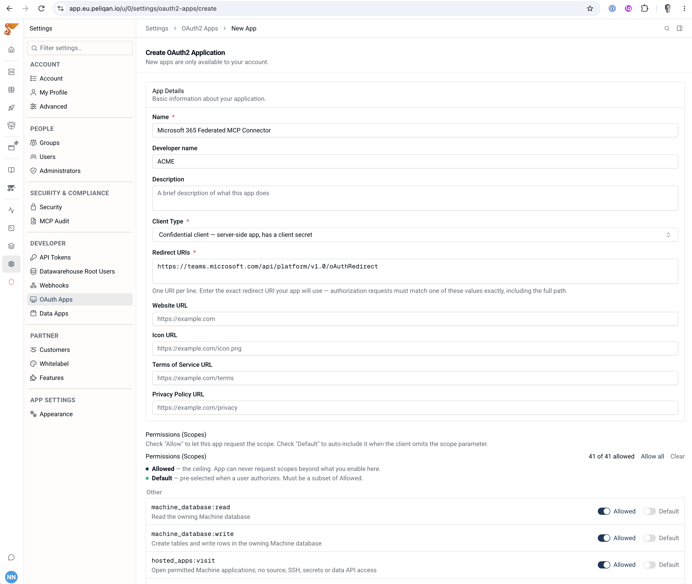

  <table>
    <colgroup>
      <col width="195" />
      <col width="409" />
    </colgroup>
    <thead>
      <tr>
        <th>Setting</th>
        <th>Value</th>
      </tr>
    </thead>
    <tbody>
      <tr>
        <td>Name</td>
        <td>e.g. "MS 365 Federated MCP Connector"</td>
      </tr>
      <tr>
        <td>Developer name</td>
        <td>Use your own company name</td>
      </tr>
      <tr>
        <td>Redirect URI</td>
        <td>`https://teams.microsoft.com/api/platform/v1.0/oAuthRedirect`</td>
      </tr>
      <tr>
        <td>Client type</td>
        <td>Confidential client</td>
      </tr>
      <tr>
        <td>Scopes</td>
        <td>Enable the scope you want to include</td>
      </tr>
    </tbody>
  </table>

  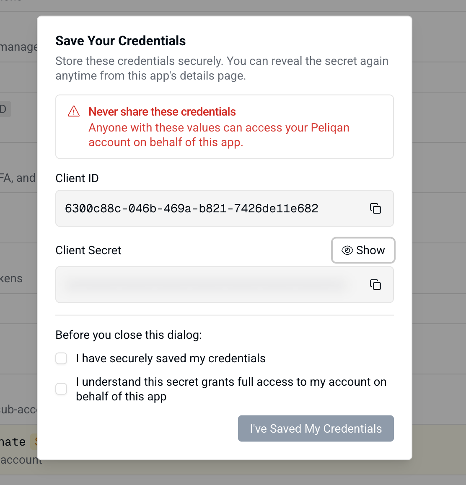

  Copy the Client ID and Client Secret.

  # Register an OAuth client in Teams Developer portal

  [https://dev.teams.microsoft.com/tools](https://dev.teams.microsoft.com/tools) → OAuth client registration

  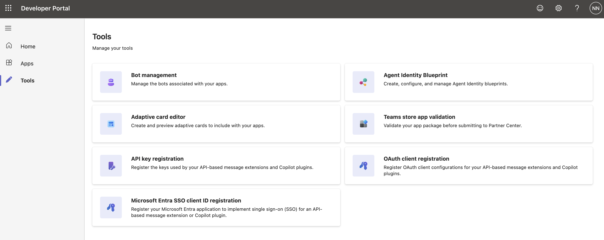

  Click on Register Client:

  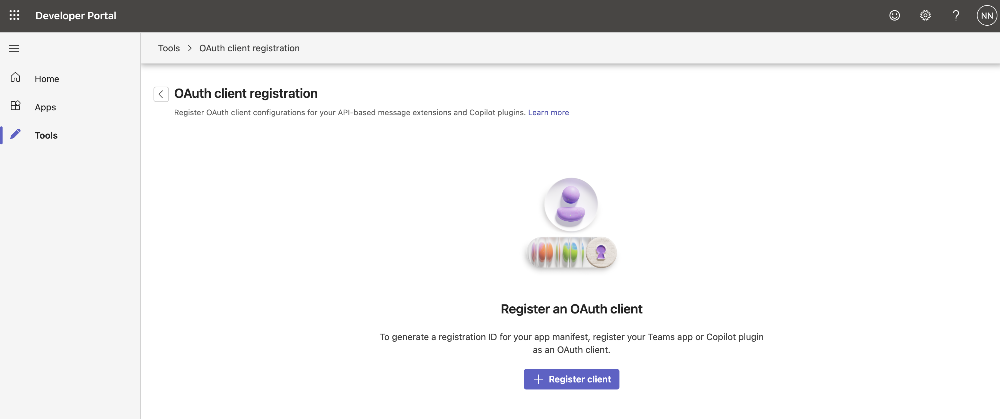

  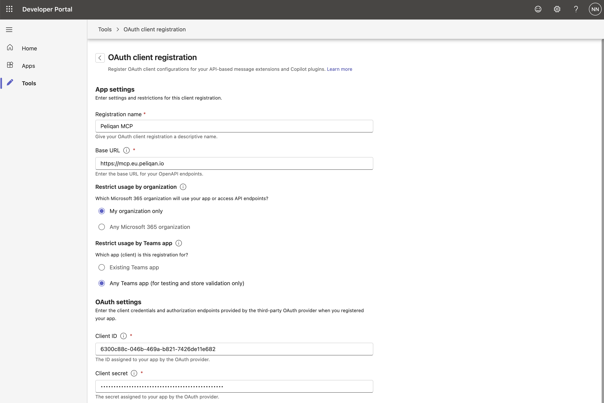

  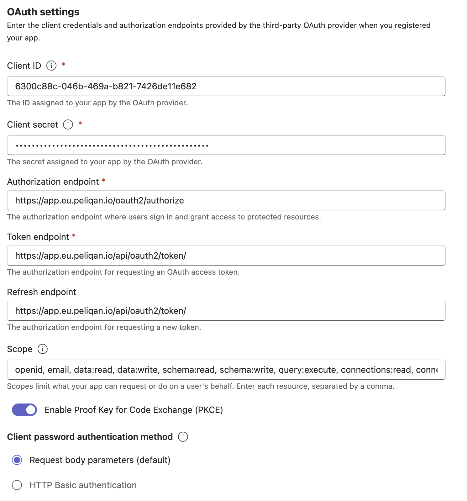

  <table>
    <colgroup>
      <col width="199" />
      <col width="398" />
    </colgroup>
    <thead>
      <tr>
        <th>Setting</th>
        <th>Value</th>
      </tr>
    </thead>
    <tbody>
      <tr>
        <td>Base URL</td>
        <td>`https://mcp.eu.peliqan.io`</td>
      </tr>
      <tr>
        <td>Client ID</td>
        <td>From the Peliqan OAuth app create above</td>
      </tr>
      <tr>
        <td>Client Secret</td>
        <td>From the Peliqan OAuth app created above</td>
      </tr>
      <tr>
        <td>Authorization endpoint</td>
        <td>`https://app.eu.peliqan.io/oauth2/authorize`</td>
      </tr>
      <tr>
        <td>Token endpoint</td>
        <td>`https://app.eu.peliqan.io/api/oauth2/token/`</td>
      </tr>
      <tr>
        <td>Refresh endpoint</td>
        <td>`https://app.eu.peliqan.io/api/oauth2/token/`</td>
      </tr>
      <tr>
        <td>Scope (\*)</td>
        <td>openid, email, data:read, schema:read, query:execute, connections:read</td>
      </tr>
    </tbody>
  </table>

  (\*) Add all scopes from your Peliqan OAuth app that you want to include.

  Click save, and copy the OAuth client registration ID:

  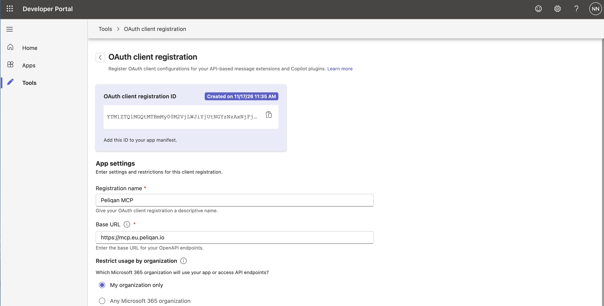

  # Add a Copilot Connector in MS 365 Admin center

  [https://admin.cloud.microsoft](https://admin.cloud.microsoft) → Copilot → Connectors

  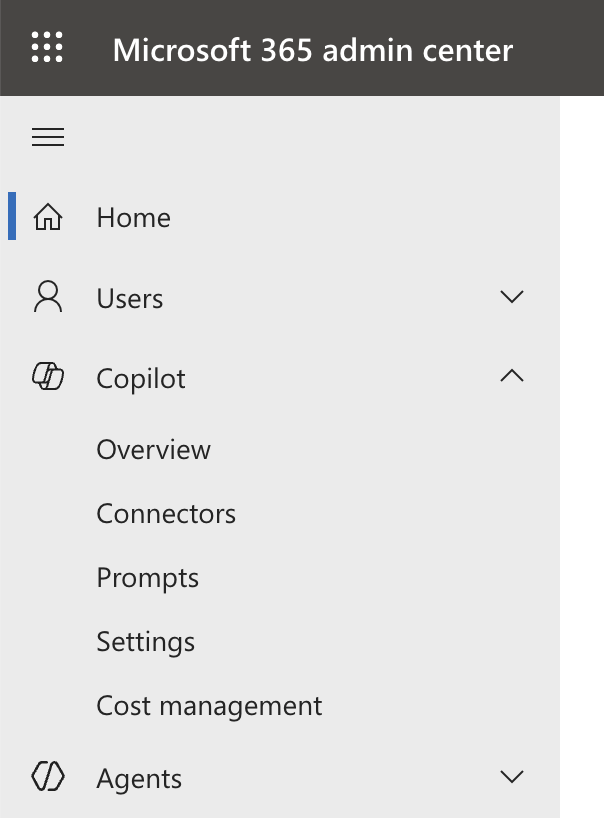

  Connectors → Gallery → Made by your org → Add.

  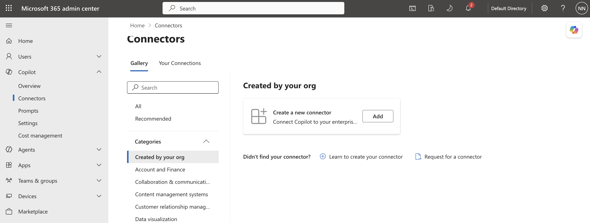

  Connect to MCP Server → Add.

  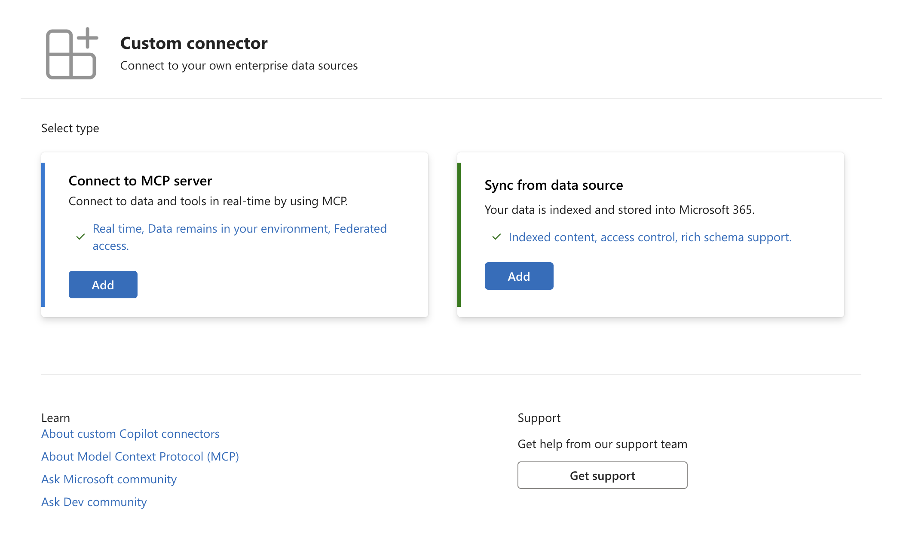

  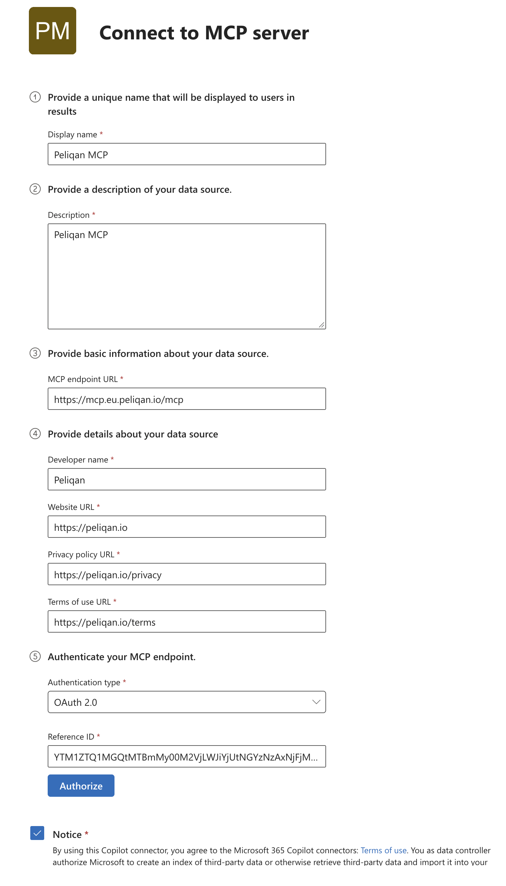

  <table>
    <colgroup>
      <col width="201" />
      <col width="392" />
    </colgroup>
    <thead>
      <tr>
        <th>Setting</th>
        <th>Value</th>
      </tr>
    </thead>
    <tbody>
      <tr>
        <td>Name</td>
        <td>Peliqan MCP</td>
      </tr>
      <tr>
        <td>Description</td>
        <td>Peliqan MCP</td>
      </tr>
      <tr>
        <td>MCP endpoint URL</td>
        <td>`https://mcp.eu.peliqan.io/mcp`</td>
      </tr>
      <tr>
        <td>Authentication type</td>
        <td>`OAuth 2.0`</td>
      </tr>
      <tr>
        <td>Reference ID</td>
        <td>OAuth client registration ID from the above step</td>
      </tr>
    </tbody>
  </table>

  Click on Authorize. You will be redirected to Peliqan. Click on "Allow access".

  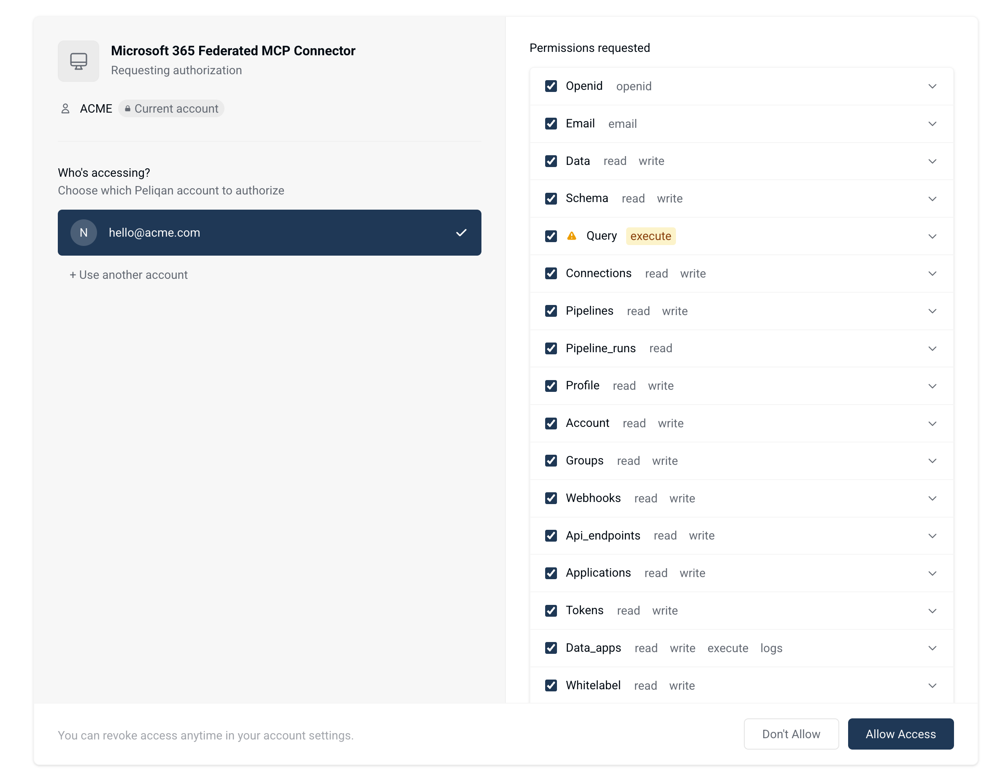

  Next, click on Create to finalize the creation of the MCP Server in MS 365 Admin Center. Wait 1 minute. Check the status of the connector under "Your connectors":

  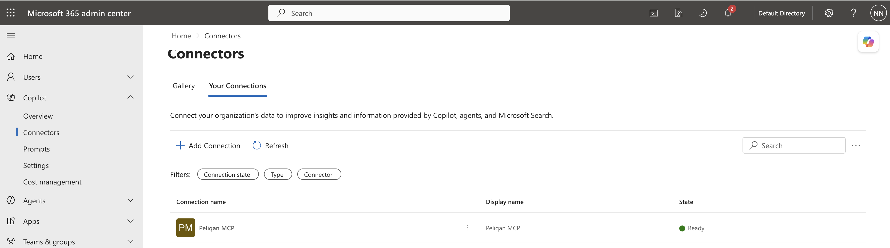

  # Add a source in Copilot

  In Copilot go to Settings → Sources.

  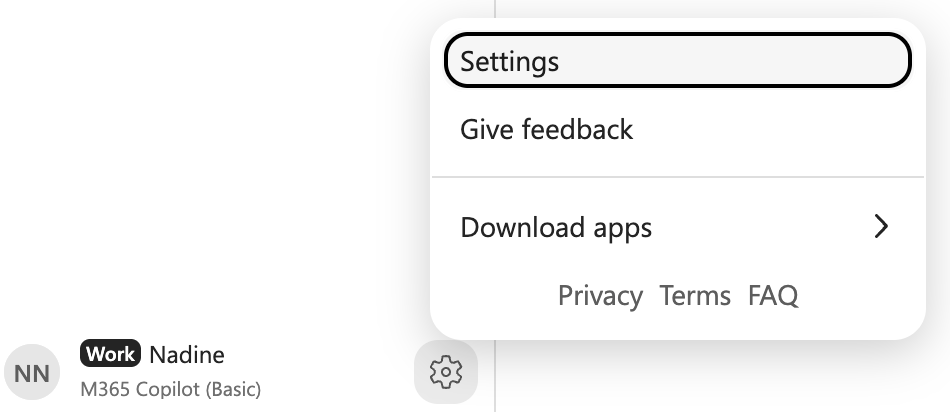

  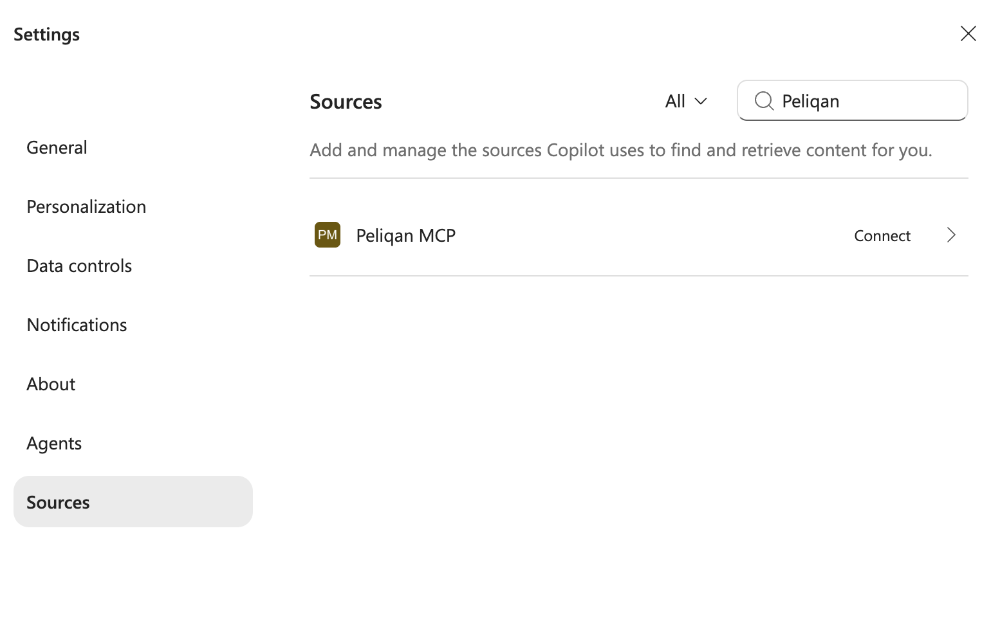

  Search for Peliqan MCP, click on "Connect".

  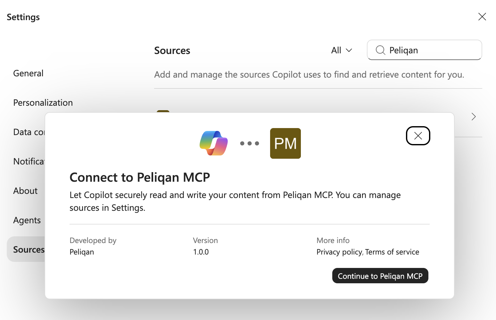

  Now you can use this source in Copilot.
</Accordion>

<Accordion title="Setup in other MCP Clients">
  Check your client's documentation on how to add an MCP Server. You can use any MCP-compatible AI client that supports HTTPS transport, and connect using the Peliqan MCP Server URL:

  - EU customers: use `https://mcp.eu.peliqan.io/mcp`
  - US customers: use `https://mcp.us.peliqan.io/mcp`
</Accordion>

## Verifying the connection

Once connected, try these prompts to confirm everything is working:

- _"List my Peliqan connections"_
- _"Show me all databases in my Peliqan account"_
- _"List my data apps"_

If you see results from your Peliqan account, you're all set.

## What the Peliqan MCP Server can do

### Debug connections & pipelines

- See all your data source connections and their sync status
- View recent pipeline run history
- Read raw error logs when a sync fails

### Explore your data

- Browse all databases, schemas, and tables
- Inspect column names and types
- Preview rows of data

### Manage query tables

- View run history and error logs for a failing query table
- Check upstream/downstream dependencies before making changes
- Create, update, and delete SQL query tables
- Test fixes in an isolated schema before applying to production

### Build & run Data Apps

- Write Python scripts and run them as background jobs (shell mode)
- Create interactive Streamlit web UIs and publish them with a shareable URL
- Build HTTP API handlers and expose them as REST endpoints
- Schedule scripts to run automatically
- Get and set the state of Data Apps (e.g. get configuration of an app, stored in the state)

### Manage API endpoints

- Create, update, and delete HTTP endpoints backed by your Python scripts
- View recent call logs for any endpoint

### Sub-account management _(partner accounts only)_

- List all customer sub-accounts
- Run any tool against a specific sub-account by passing `sub_account_id`

## Resources the AI can read

| Resource URI | What it contains |
| --- | --- |
| `peliqan://guide` | Peliqan AI agent guide with use cases and workflows to use |

These resources are automatically available to the AI — no extra setup needed.

## Example prompts to get started

<Accordion title="Debug a failing sync">
  > _"My Salesforce connection hasn't synced since yesterday. Can you check what's wrong and show me the error logs?"_

  The AI will list connections, find the failing run, and read the logs for you.
</Accordion>

<Accordion title="Explore your data model">
  > _"Show me what tables exist in the 'analytics' schema and preview the first 10 rows of the orders table."_

  The AI will browse schemas and return a data preview.
</Accordion>

<Accordion title="Write and run a data app">
  > _"Write a Python script that reads from our Stripe connection, calculates monthly revenue, and prints the results. Run it now."_

  The AI will write the script, create a data app, and run it in shell mode — returning the output in the chat.
</Accordion>

<Accordion title="Fix a broken query table">
  > _"Query table 'monthly_summary' is failing. Can you diagnose the issue and fix it?"_

  The AI will read the run logs, identify the error, test a fix in a temp schema, and apply it to production.
</Accordion>

## Build a custom MCP Server

Peliqan also allows you to implement your own custom MCP Server, for internal use and/or for your customers and partners. More information:

[Build a custom MCP Server on Peliqan](/low-code-python-data-apps/by-protocol-rest-webhooks-mqtt/mcp-model-context-protocol/build-a-remote-mcp-server-on-peliqan)

## Need help?

Reach out to Peliqan support: [support@peliqan.io](mailto:support@peliqan.io). You can also ask your AI (e.g. Claude) directly. Once the Peliqan MCP Server is connected, the AI has full context on how Peliqan works.
