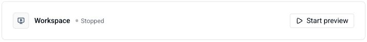
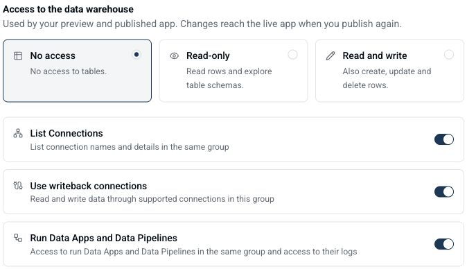
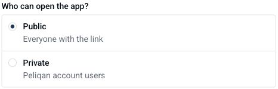
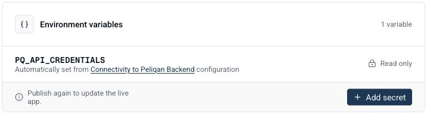
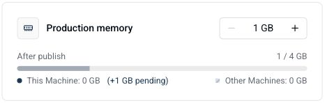

Peliqan Machines let you build and host web apps on Peliqan. Use Peliqan AI to build your app, connect your own coding agent, or import an existing project.

For example, you can build a sales dashboard, a customer portal or an internal tool that works with your Peliqan data. Develop and test the app in **Development**, then publish a separate release for your users in **Production**.

## Machines or Data Apps?

Peliqan supports both Machines and [Data Apps](/data-apps).

|  | Data App | Peliqan Machine |
| --- | --- | --- |
| Project | A Python script | A project with multiple files |
| User interface | Typically Streamlit | A web frontend, such as React |
| **Execution environment** | Peliqan Data app VMs | Peliqan Machines (VMs) |
| Development | The Data App editor or your own IDE | Peliqan AI, the Code editor or your own coding agent |
| Typical use cases | Scheduled scripts, data processing, APIs and Streamlit apps | Dashboards, portals and custom web apps |

The standard Machine starter uses React, TypeScript and TanStack Start, with a Python/FastAPI backend. You can also import an existing project. Check its development command and production build before publishing.

## Create a Machine

You need access to Peliqan Machines and permission to create a Machine in the selected group.

1. In Peliqan, go to **Peliqan Machines** in the left menu.
2. Click **New Machine**, enter a **Machine name** and select a **Group**.
3. Describe what you want to build and click **Build with Peliqan AI**. Continue the conversation to work out the screens, data and actions your app needs.
4. Review the proposed data access and capabilities before you choose **Create and build**.
5. Open the Machine to review the code and test its Development preview.

For example, you can start with:

> Build a sales dashboard with a date filter, monthly revenue chart and a table of open orders. Use the sales data in this group. The dashboard should only read data.

To create a Machine without Peliqan AI, enter a **Machine name**, select a **Group** and click **Build with your agent**. In the workspace, open **Connect your agent** to connect your coding agent.

<Note>
  Discussing access in the planning chat does not enable it. A group admin must approve the Machine's Peliqan data access. You can leave access off and configure it later.
</Note>

## Development and Production

Development is your editable workspace. Production runs the release that you have published.

| Action or setting | Development | Production |
| --- | --- | --- |
| App URL | Temporary, randomly generated preview URL | Stable across publishes. Choose a URL name in **Publish**, or keep the generated name |
| Edit code and click **Save changes** | Updates the saved workspace source | The live release keeps running |
| Start or restart the preview | Runs your workspace for testing | Does not publish your changes |
| Change environment variables or Peliqan connectivity | Applies the saved settings to the workspace | Publish again to apply them to the live app |
| Publish | Uses the saved workspace as the source | Builds, checks and deploys a new release |
| Restore a checkpoint from **History** | Replaces the workspace source | The live release is unchanged |

### Test your app

Open **Preview** to test the app. If the workspace is stopped, click **Start preview**. You can also start or restart it under **Settings**.



The Development workspace stops after a period of inactivity. Start it again when you want to continue working. A Development preview URL is temporary and requires a Peliqan user with permission to view the Machine.

Use **Code** to browse and edit project files. Save your changes before publishing. Use Peliqan AI in the Machine workspace to continue building or to investigate an error.

### Connect your own coding agent

You can work with a coding agent such as Claude Code from your own computer.

1. Open **Connect your agent** in the Machine workspace.
2. Install the Peliqan CLI using the command shown for your operating system. Python 3 and OpenSSH are required.
3. Sign in and connect to the Machine using the commands shown in the dialog:

```bash
peliqan login
peliqan machines connect <machine-id>
```

4. Click **Download instructions** and give the downloaded `instructions.md` file to your agent.
5. Ask your agent to follow those instructions when editing and testing the app.

The agent connects to Development. Publishing to Production is a separate operation.

### Import an existing project

In **Code**, use **Import ZIP** or **Import GitHub repository**. Review the files and the app's startup instructions, then test the Development preview.

Importing a GitHub repository copies its files into the Machine. It does not set up continuous synchronisation with GitHub.

For a custom production build, add a `Dockerfile` at the project root. See [Advanced: custom Dockerfiles](/peliqan-machines/advanced#use-a-custom-dockerfile).

## Connect to Peliqan data

Open **Connectivity to Peliqan backend** to review or change the Machine's connection. A group admin manages these settings.

Choose the table access your app needs:

- **No access**: the Machine cannot access Peliqan tables through its managed connection.
- **Read-only**: the Machine can read rows and explore table schemas in its group.
- **Read and write**: the Machine can also create, update and delete rows in its group.

Table access covers the current and future tables in the Machine's group. Use a separate group when an app should have access to a different set of data.

The following capabilities are configured separately from table access:

| Capability | Use it when the app needs to… |
| --- | --- |
| **List Connections** | List connection names and details in the same group |
| **Use writeback connections** | Read and write data through supported connections in the same group |
| **Run Data Apps and Data Pipelines** | Run existing Data Apps and eligible Data Pipelines in the same group and access their runs and logs |



Select only the capabilities needed by your app. For example, a dashboard that only reads warehouse tables does not need writeback or workflow execution. A workflow can change data even when the Machine's direct table access is read-only or off.

Click **Save configuration** after changing the settings. Development applies the saved configuration; publish again to update Production. Revoking managed access can affect a live app immediately, so review the impact before removing a connection.

<Note>
  Peliqan manages the Machine's backend credentials. You do not need to copy your personal Peliqan API key into the app. Use managed credentials only from the backend, and store other secret values in environment settings.
</Note>

## Choose who can open your app

In the **Publish** dialog, choose one of the following authentication options:

| Option | Who can open the published app? |
| --- | --- |
| **Public** | Everyone with the link |
| **Private** | Signed-in users of the same Peliqan account |



**Private** requires a Peliqan login. Users can use the login methods enabled for their account, such as a password, Microsoft or Google. See [User management](/user-management) and [SSO with Microsoft](/sso-with-microsoft).

**Public** and **Private** control who can access the application itself. They do not define user-specific permissions inside the app. To add your own login flow and access Peliqan data on behalf of the signed-in user, see [How to integrate with the Peliqan OAuth2 server](/vibe-coding-apps-peliqan-as-backend/how-to-integrate-with-the-peliqan-oauth2-server).

## Add environment variables

Store external API credentials and other runtime settings under **Settings > Environment variables**.

1. Click **Add secret**.
2. Enter the variable name and value.
3. Save the setting. Development reloads to apply it; start the preview if it is stopped.
4. Publish again when the setting should be used by Production.



Values are stored encrypted. Existing values are not displayed again. Replace a value if you need to change it.

Variables managed by Peliqan, such as `PQ_API_CREDENTIALS`, are read-only. Configure these through **Connectivity to Peliqan backend**. Platform variables and browser-public prefixes, such as `PORT` and `VITE_`, are reserved.

<Warning>
  Keep secrets out of frontend code, source files and Docker images. Frontend code is delivered to the user's browser. Set runtime secrets in the Machine settings and read them from the backend.
</Warning>

## Publish your app

Publish when you want a separate production release for your users.

1. Save your changes and test the Development preview.
2. Click **Publish**.
3. Choose the app's URL name and **Public** or **Private** access.
4. Review the Production memory allocation and click **Publish** in the dialog.
5. Follow the build and security-check progress. Review any findings that need attention.
6. Once the release is live, use **Open live app** to test the published URL.

Publishing uses a snapshot of the saved code, environment variables, approved Peliqan data access and visitor-access setting. Later workspace changes do not automatically update that release.

### Review security findings

Open **Findings** to inspect the available scan results. Publishing checks both the saved source and the built production image.

- **Critical findings or detected secrets** block publishing. Fix the issue and publish again.
- **High findings** require review and an explicit **Approve & deploy** action by an authorised user.
- **Medium findings** remain visible for review.
- A missing, failed or incomplete required scan must be resolved before deployment can continue. It is not an approval that can be bypassed.

Approval applies to the reviewed release and expires after 24 hours. Changes to the source or build may require a new review.

If a new publish fails or is waiting for approval, the current live release keeps running. Use **View deployment logs** to investigate the failed attempt. Scans help find issues, but do not replace testing the app and reviewing its access rules.

### Restore the previous live release

When an eligible previous release is available, open **Publish** and choose **Restore previous release**. Review the confirmation before continuing.

This restores the earlier successful code and image while keeping the current live release's environment variables, Peliqan access and visitor-access settings. It does not revert credentials to an older value.

## Configure Production memory

Open **Settings > Production memory**, or select the allocation in the **Publish** dialog.

Choose between **1 GB and 4 GB**, in steps of 1 GB, within the available capacity of your account. The allocation display shows the memory assigned to this Machine and to other Machines in the account.



Click **Apply changes** to resize an active Production app. This restarts the app without publishing new code. If the app is not published yet, the saved allocation applies on its next publish.

See [Advanced: CPU and memory](/peliqan-machines/advanced#cpu-and-memory) for the runtime limits.

## Workspace history

Open **History** to see saved checkpoints from manual changes, Peliqan AI and connected coding agents, together with successful published releases.

### Preview a checkpoint

Click **Preview** on a checkpoint to inspect its saved frontend. This runs in a browser sandbox and does not start or change the Development workspace.

A history preview is a visual preview. It does not run the saved backend. Features that depend on API calls, browser storage, external runtimes or server rendering may be unavailable. Dependency downloads can also take time or fail.

Preview links require sign-in and permission to view the Machine. A link expires after 24 hours; reopen it from **History** to generate a new one.

### Restore a checkpoint

Click **Restore** and confirm to replace the Development source with the selected checkpoint. Peliqan creates a recovery checkpoint before restoring changed source.

Restoring workspace history does not change environment variables, Peliqan connectivity or the live Production release. Test the restored code in Development, then publish if you want it to become live.

## Troubleshooting

### The preview has stopped

Development can stop after inactivity. Open **Preview** or **Settings** and click **Start preview**. Check the startup logs if it does not become ready.

### My saved changes are not in the live app

Saving changes updates Development. Publish again to create a production release with the new code and settings. Check the live release and its deployment logs if a publish did not finish.

### A source file is rejected before scanning

Source validation checks file paths, file sizes, secret files and credential patterns before a scan or build starts. Store secret values in environment variables and read them from backend code. If ordinary text is being incorrectly identified as a credential reference, contact [Peliqan Support](mailto:support@peliqan.io) with the error and file path.

### A history preview is blank or shows a dependency error

Retry the preview, or open it again from **History**. A rendered page may still have an unavailable dependency or feature. Use Development to test the full app with its backend and approved connection settings.

### I cannot apply a memory change

Check the account allocation display and wait for any publish in progress to finish. Another Production Machine may be using the available memory. If a previous resize could not be confirmed, retry **Apply changes** and check the deployment status.

## Advanced

For custom Dockerfiles, cron jobs, the container OS, resource limits and network restrictions, see [Advanced Machine configuration](/peliqan-machines/advanced).

Scheduled background work can also run as a [scheduled Data App](/low-code-python-data-apps/running-apps-manual-schedule-etc), independently of the web app.

## More info

- [Permissions](/permissions)
- [User management and login options](/user-management)
- [Peliqan OAuth2 Server](/vibe-coding-apps-peliqan-as-backend/how-to-integrate-with-the-peliqan-oauth2-server)
- [Data Apps - low code Python](/data-apps)
