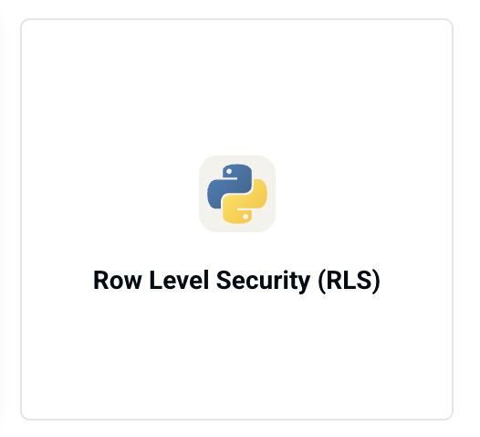

## Apply row level security (RLS) in the Peliqan data warehouse

Install the Data App template "Row Level Security (RLS)", update the configuration section and run the Data App. This will enforce RLS on a given table, directly in the Peliqan data warehouse.



## Apply row level security (RLS) in code

If the above scenario is not possible (applying RLS directly in the DWH), you can also apply RLS in code, for example in a Data App or in a custom MCP Server.

### User authentication

In order to apply row-level permissions, each individual user must be authenticated and known to Peliqan. This means that a shared API key cannot be used. Instead SSO (Single Sign On) with OAuth is appropriate.

More info:

[Publish & Embed apps](/low-code-python-data-apps/publish-apps)

[Custom MCP with OAuth](/custom-mcp-with-o-auth) 

### Implementation of RLS in code

Row level access is implemented by providing the client with a set of **views**, making sure each **view** has a fixed column on which permissions can be applied (e.g. `user_role`).

The **views** are invoked with a filter (e.g. a filter on `user_role`) and then prepended as CTEs to the SQL query that the client wants to execute.

### Example

In this example, we assume that users have one single user role, user roles have permissions on zero, one or more departments and all resources are linked to one single department.

Example description of the **Data model** which is exposed to the client:

```none
* Table invoices:     id, amount, date, department etc.
* Table customers:    id, name, department etc.
* Table payments:     id, amount, department etc.
* etc.
```

Example table **invoices**:

| id | amount | date | department |
| --- | --- | --- | --- |
| INV-101 | \$100 | 2026-10-01 | HRM |
| INV-102 | \$200 | 2026-10-05 | HRM |
| INV-103 | \$150 | 2026-10-08 | Sales |
| INV-104 | \$70 | 2026-10-08 | Finance |

Example table with mapping of **permissions**:

| **department** | **allowed_role** |
| --- | --- |
| HRM | HR Manager |
| HRM | Finance Manager |
| Sales | Sales Manager |
| Sales | Finance Manager |

Example table with **users**, each user has one **user_role**:

<table>
  <colgroup>
    <col width="114" />
    <col width="152" />
  </colgroup>
  <thead>
    <tr>
      <th>**user**</th>
      <th>**user_role**</th>
    </tr>
  </thead>
  <tbody>
    <tr>
      <td>Bob</td>
      <td>HR Manager</td>
    </tr>
    <tr>
      <td>Anne</td>
      <td>Finance Manager</td>
    </tr>
  </tbody>
</table>

Example **access views** to apply permissions:

```sql
CREATE VIEW invoices_view AS
   SELECT 
       invoices.*,
       permissions.allowed_role
   FROM invoices
   INNER JOIN permissions ON invoices.department = permissions.department;

CREATE VIEW customers_view AS ...
CREATE VIEW payments_view AS ...
```

In this example we assume the user is using a **Custom MCP Server**. The user asks for the "Sum of invoices". The MCP Server converts the question using text-to-SQL into the following SQL query:

```sql
SELECT SUM(amount) FROM invoices;
```

All available **access views** are prepended (including a filter to apply the permissions) to the SQL query from the user:

```sql
WITH 
  invoices   AS (SELECT * FROM invoices_view  WHERE allowed_role = '{user_role}'),
  customers  AS (SELECT * FROM customers_view WHERE allowed_role = '{user_role}'),
  payments   AS (SELECT * FROM payments_view  WHERE allowed_role = '{user_role}')

SELECT SUM(amount) FROM invoices;  
```

Below is the final executed query for **Bob**, with **user_role** = 'HR Manager':

```sql
WITH 
  invoices   AS (SELECT * FROM invoices_view  WHERE allowed_role = 'HR Manager'),
  customers  AS (SELECT * FROM customers_view WHERE allowed_role = 'HR Manager'),
  payments   AS (SELECT * FROM payments_view  WHERE allowed_role = 'HR Manager')

SELECT SUM(amount) FROM invoices;
```

Result for Bob:

| id | amount | date | department |
| --- | --- | --- | --- |
| INV-101 | \$100 | 2026-10-01 | HRM |
| INV-102 | \$200 | 2026-10-05 | HRM |
| **SUM:** | **\$300** |  |  |

Final executed query for **Anne**, with **user_role** = 'Finance Manager':

```sql
WITH 
  invoices   AS (SELECT * FROM invoices_view  WHERE allowed_role = 'Finance Manager'),
  customers  AS (SELECT * FROM customers_view WHERE allowed_role = 'Finance Manager'),
  payments   AS (SELECT * FROM payments_view  WHERE allowed_role = 'Finance Manager')

SELECT SUM(amount) FROM invoices;
```

Result for Anne:

| id | amount | date | department |
| --- | --- | --- | --- |
| INV-101 | \$100 | 2026-10-01 | HRM |
| INV-102 | \$200 | 2026-10-05 | HRM |
| INV-103 | \$150 | 2026-10-08 | Sales |
| **SUM:** | **\$450** |  |  |

Here is the source code for the custom MCP server, which applies the above Row Level Security method, see function `execute_query()`:

<Accordion title="Click to expand code">
  ```text
  # Change below API keys and put them in Peliqan's secret store (under Connections) for production use.
  api_key_1 = "df10c215-274e-4672-938a-7d264beac434"  # Bob - for demo only, move to secret store
  api_key_2 = "1a9d5eb4-93f7-4de3-b6aa-67ebf22e7bc0"  # Lucas - for demo only, move to secret store
  
  API_KEYS = {
      api_key_1: "bob",
      api_key_2: "lucas",
  }
  
  import json
  import inspect
  from typing import get_type_hints
  from typing import List, Dict, Any
  from urllib.parse import parse_qs
  
  CURRENT_USERNAME = None
  
  dbconn = pq.dbconnect(pq.DW_NAME)
  
  MCP_ACCESS_SCHEMA = "MCP Access"
  
  MCP_TOOLS = []
  class mcp:
      def tool():
          def decorator(func):
              sig = inspect.signature(func)
              type_hints = get_type_hints(func)
  
              # parse descriptions from docstring using :param style
              raw_doc = func.__doc__ or ""
              param_docs = {}
              for line in raw_doc.splitlines():
                  line = line.strip()
                  if line.startswith(":param"):
                      try:
                          _, rest = line.split("param", 1)
                          name, desc = rest.split(":", 1)
                          param_docs[name.strip()] = desc.strip()
                      except ValueError:
                          pass
              properties = {}
              required = []
  
              for name, param in sig.parameters.items():
                  hint = type_hints.get(name, "any")
                  type_str = hint.__name__ if isinstance(hint, type) else str(hint)
  
                  if type_str == "str":
                      mcp_type_str = "string"
                  elif type_str == "int":
                      mcp_type_str = "number"
                  else:
                      mcp_type_str = "string"
  
                  prop = {
                      "type": mcp_type_str,
                      "description": param_docs.get(name, "")
                  }
                  if param.default is not inspect._empty:
                      prop["default"] = param.default
                  else:
                      required.append(name)
                  properties[name] = prop
  
              MCP_TOOLS.append({
                  "name": func.__name__,
                  "description": raw_doc.strip().split("\n")[0] if raw_doc else "",
                  "inputSchema": {
                      "type": "object",
                      "properties": properties,
                      "required": required
                  }
              })
              return func
          return decorator
  
  def get_tool_response_format(tool_name):
      func = globals().get(tool_name)
      response_annotation = inspect.signature(func).return_annotation
      if hasattr(response_annotation, "__name__"):
          return response_annotation.__name__
      return str(response_annotation).replace("typing.", "").replace("class '", "").replace("'>","")
  
  ########################### ADD MCP TOOLS BELOW ###########################
  
  @mcp.tool()
  def list_tables() -> List[Dict[str, Any]]:
      """
      Returns the access views available through this MCP server, discovered live
      from the "MCP Access" schema. Each one is already scoped to the authenticated
      caller's row-level access permissions - there is no way to query the underlying
      source tables directly.
      """
      views = []
      for db in pq.list_databases():
          for table in db["tables"]:
              schema_name = next((s["name"] for s in db["schemas"] if s["id"] == table["schema_id"]), None)
              if schema_name != MCP_ACCESS_SCHEMA:
                  continue
              table_meta = pq.get_table(table["id"])
              views.append({"table": table["name"], "query": table_meta.get("query", "") or ""})
      return views
  
  @mcp.tool()
  def execute_query(query: str) -> List[Dict[str, Any]]:
      """
      Executes an SQL query on the data warehouse and returns a list of rows.
      Row-level access views (see list_tables) are automatically prepended as CTEs,
      scoped to the authenticated caller - only SELECT is allowed.
      """
      query = query.replace('"' + pq.DW_NAME + '".', '').replace(pq.DW_NAME + '.', '')
  
      cte_defs = ",\n".join(
          f"{view['table']} AS ({view['query'].replace('{username}', CURRENT_USERNAME)})"
          for view in list_tables()
      )
      query = f"WITH {cte_defs}\n{query}"
  
      print("Final SQL query to execute:")
      print(query)
      rows = dbconn.fetch(pq.DW_NAME, query = query)
      return rows
  
  ########################### END OF MCP TOOLS ###########################
  
  
  def log_request(request):
      print("request method: ", request['method'])
      print("request url: ", request['url'])
      print("request query string: ", request['query_string'])
      print("request body:")
      try:
          print(json.dumps(request['data'], indent=2))
      except:
          print(request['data'])
  
  def log_response(response):
      print("Response:")
      print(json.dumps(response, indent=2))
  
  def mcp_response_initialize(id):
      return {
          "jsonrpc": "2.0",
          "id": id,
          "result": {
              "protocolVersion": "2025-03-26",
              "capabilities": {
                  "callTool": True,
                  "listTools": True,
                  "tools": {"listChanged": False}
              },
              "serverInfo": {"name": "peliqan-mcp", "version": "0.0.1"}
          }
      }
  
  def mcp_response_tools_list(id):
      return {"jsonrpc": "2.0", "id": id, "result": {"tools": MCP_TOOLS}}
  
  def mcp_response_tools_call(id, response_type):
      return {
          "jsonrpc": "2.0",
          "id": id,
          "result": {
              "content": [{"type": response_type, response_type: ""}],
              "isError": False
          }
      }
  
  def check_api_key(request):
      global CURRENT_USERNAME
      query_string_parsed = parse_qs(request.get("query_string", ""))
      request_api_key = query_string_parsed["api_key"][0] if "api_key" in query_string_parsed else None
      username = API_KEYS.get(request_api_key)
      if not username:
          print("Incorrect or unknown API key, stopping")
          return False
      CURRENT_USERNAME = username
      return True
  
  def handler(request):
      log_request(request)
      if not check_api_key(request):
          return "Unauthorized", 401
  
      data = request['data']
      if not data:
          data = "{}"
      mcp_req = json.loads(data)
  
      id = mcp_req.get("id", 0)
      mcp_response = mcp_response_initialize(id)
  
      method = mcp_req.get("method")
      if method == "initialize":
          mcp_response = mcp_response_initialize(id)
      elif method == "notifications/initialized":
          return "", 202
      elif method == "tools/list":
          mcp_response = mcp_response_tools_list(id)
      elif method == "tools/call":
          tool_name = mcp_req["params"]["name"]
          args = mcp_req["params"].get("arguments", {})
  
          isError = False
          try:
              tool_response = globals()[tool_name](**args)
          except Exception as e:
              print(e)
              tool_response = str(e)
              isError = True
  
          tool_response_format = get_tool_response_format(tool_name)
          response_type = "text"
          mcp_response = mcp_response_tools_call(id, response_type)
          if isError:
              mcp_response["result"]["isError"] = isError
  
          if tool_response_format == "str":
              mcp_response["result"]["content"][0][response_type] = tool_response
          else:
              mcp_response["result"]["content"][0][response_type] = json.dumps(tool_response)
  
      log_response(mcp_response)
      return mcp_response
  ```
</Accordion>
