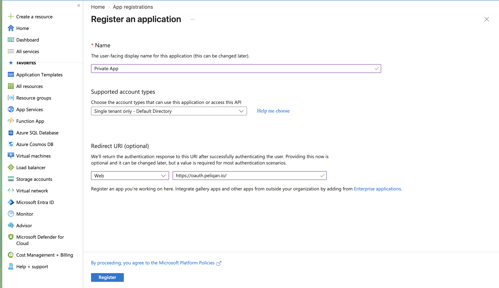
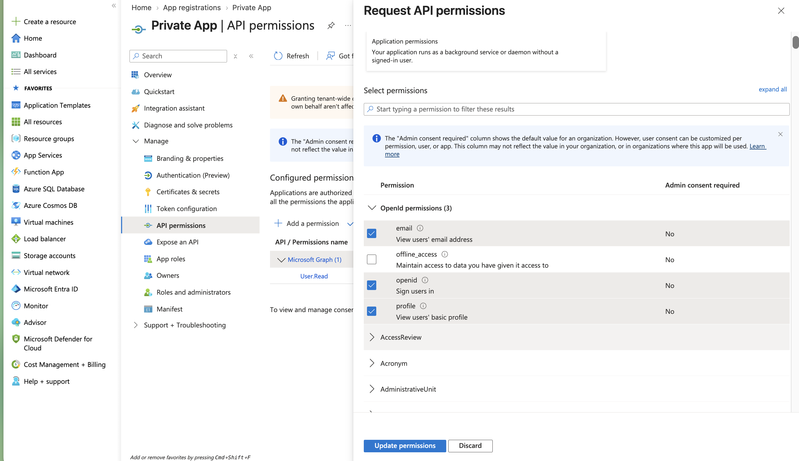
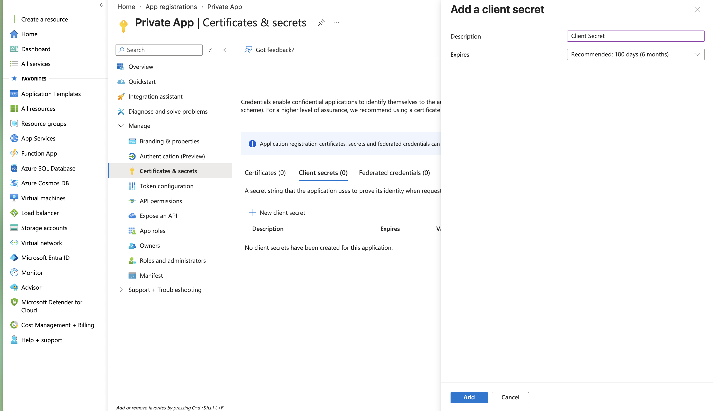
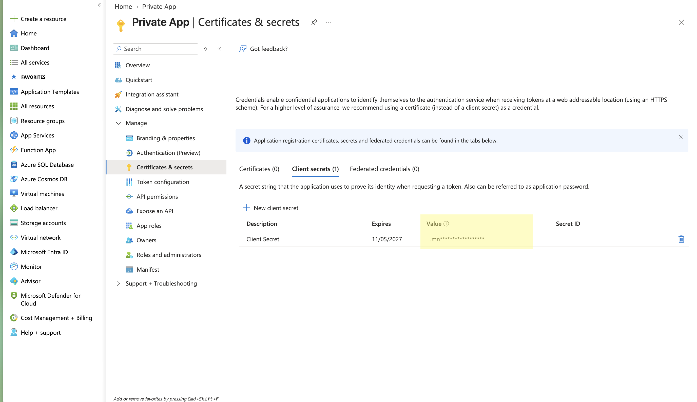

By default, "Sign in with Microsoft" uses the Peliqan SSO application, which your Azure administrator has to approve in your tenant. If your organization doesn't allow approving external apps, you can create your own app in Microsoft Entra ID and have Peliqan sign your users in through it. This article covers the setup in Azure and what to send to Peliqan, who then link the app to your environment.

This is available for white-labeled environments.

# Setup in Azure

_This needs to be performed by your Azure administrator._

**Step 1.** Go to **Microsoft Entra ID → App registrations → New registration** and register an app.

- **Supported account types:** _Accounts in this organizational directory only_ (single tenant).
- **Redirect URI:** platform **Web**, value `https://oauth.peliqan.io/`

**Step 2.** Under **API permissions → Add a permission → Microsoft Graph → Delegated permissions**, add:

- `openid`
- `profile`
- `email`
- `User.Read`

Then click **Grant admin consent**. Users won't be asked to approve anything themselves.

**Step 3.** Under **Certificates & secrets → New client secret**, create a secret and copy its **Value** right away. Don't copy the Secret ID, and note that Azure only shows the value once.

**Step 4.** Optional, for group mapping: go to **Token configuration → Add groups claim** and select **Security groups**.

# Send the details to Peliqan

**Step 5.** From the app's **Overview** page, send your Peliqan contact or Peliqan support:

- **Directory (tenant) ID**
- **Application (client) ID**
- **Client secret value** from step 3

Share the secret through a secure channel. Once Peliqan has linked the app, the Microsoft button on your login page uses your app.

 ID and Directory (tenant) ID in Azure")

# Good to know

- **No fallback to the Peliqan app.** Once your app is linked, all Microsoft sign-ins on your environment go through it. If the secret is wrong or expired, sign-in fails. It doesn't silently switch to the Peliqan SSO app.
- **Client secrets expire.** Azure sets an expiry date when you create the secret. Create a new secret before the old one expires and send the new value to Peliqan. Sign-in stops working when the secret expires.
- **Single tenant only.** Peliqan signs users in through your tenant ID, so only users from that tenant can sign in. Users from another Azure tenant are refused.
- **Changing the app.** If you register a new app (new client ID), send a new secret too. The old secret isn't reused with a different client ID.
- **Switching back.** Ask Peliqan support to unlink the app. The stored secret is deleted with it, and the Microsoft button goes back to the Peliqan SSO app.
